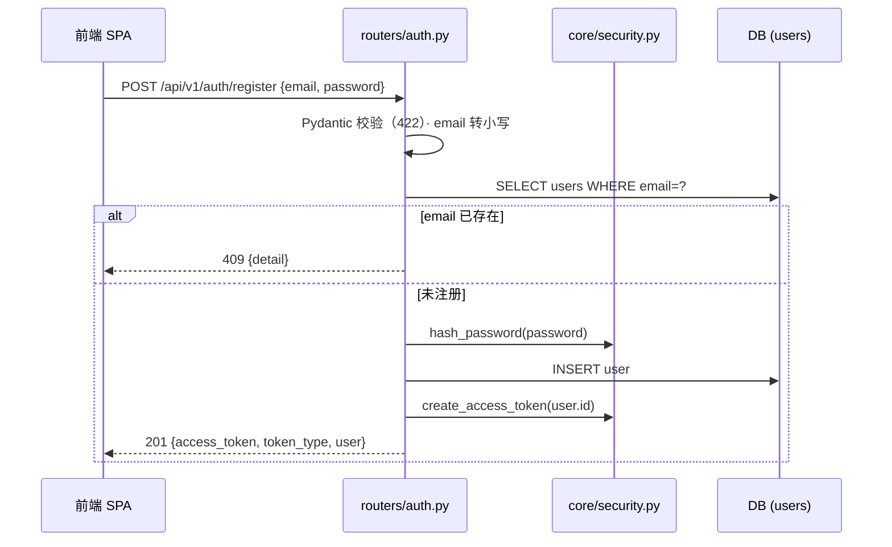
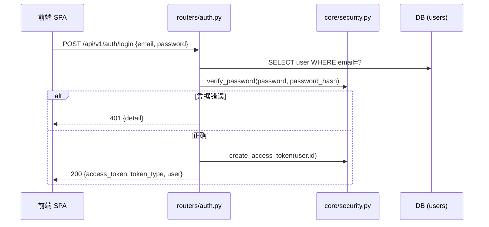
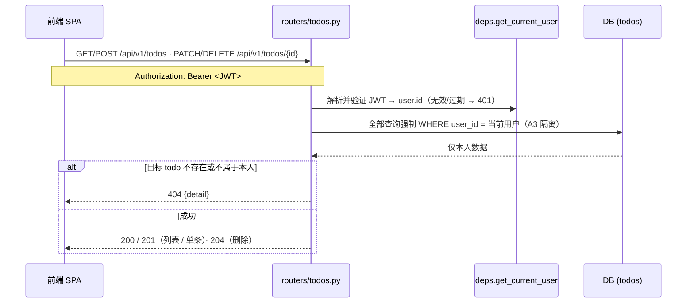

# p-001 Todo SaaS — 技术架构设计（Architecture）

> 上游产物：`requirements.md`（含假设 A1–A4）、`user-stories.yaml`（US-001~US-004）
> 本文件为 TECH_DESIGN 阶段唯一架构依据；约束 `architectureConsistency` / `apiCompleteness` 门槛以其与 `api-spec.yaml`、`database-schema.sql` 的一致性为准。

## 1. 架构风格：三层分层架构（Client–Server）

```
┌──────────────────┐   HTTPS + JSON   ┌──────────────────────┐   SQLAlchemy ORM    ┌────────────────────┐
│    frontend      │ ───────────────► │        api           │ ──────────────────► │        db          │
│  React + Vite    │    REST 调用     │  FastAPI /api/v1/*   │   方言无关模型       │ SQLite → PostgreSQL│
│  （静态构建产物）   │ ◄─────────────── │  认证 / 业务 / 数据   │ ◄────────────────── │                    │
└──────────────────┘    JSON 响应     └──────────────────────┘                     └────────────────────┘
```

- **无服务器端渲染**：前端是独立 SPA，构建产物可静态部署（假设 A2），与 API 仅通过 REST + JSON 通信。
- **无状态 API**：认证基于 JWT（无 session），API 层可水平扩展，为 Phase 7 Docker 化部署铺路。
- **数据访问隔离**：API 通过 SQLAlchemy ORM 访问数据库，禁止裸 SQL 拼接；模型层保持方言无关（假设 A1）。

## 2. 技术选型表

| 层 | 组件 | 选型 | 版本/说明 | 决策理由 |
|---|---|---|---|---|
| frontend | 框架 | React + Vite | React 18、Vite 5（Node 18+） | 假设 A2；构建产物 `dist/` 静态部署，dev server 端口 5173 |
| frontend | 路由 | React Router v6 | 三页：登录 / 注册 / 待办 | 轻量，满足 FR-4 |
| frontend | 状态 | React Context + hooks | `AuthContext` 持有 token | 规模小，不引入 Redux |
| frontend | HTTP | fetch 封装（`api/client.js`） | 统一注入 `Authorization`、401 统一跳登录 | 单一请求出口，避免 token 遗漏 |
| api | Web 框架 | FastAPI | Python 3.11+，uvicorn ASGI 运行 | 自动生成 OpenAPI 文档（`/docs`），与 `api-spec.yaml` 天然对齐 |
| api | ORM | SQLAlchemy 2.0（Declarative） | `Mapped` 风格映射 | 方言无关：Phase 2 SQLite → Phase 7 PostgreSQL 仅改连接串 |
| api | 校验 | Pydantic v2 | 请求/响应 schema | 输入校验自动 422；错误体统一 `{detail}` |
| api | 认证 | JWT（`python-jose[cryptography]`，HS256） | Bearer token，24h 过期 | 无状态、与无 session 架构匹配 |
| api | 密码 | `passlib[bcrypt]` | bcrypt rounds=12 | 只存哈希，永不落明文（FR-1） |
| db | 存储 | Phase 2: SQLite（stdlib）；Phase 7: PostgreSQL 15+ | 假设 A1 | 零依赖快速闭环；切换只改 `DATABASE_URL` |
| db | 迁移 | Alembic（Phase 7 前引入） | Phase 2 可先用 `create_all` 引导 | 避免 Phase 7 一次性迁移风险 |
| 部署 | 容器 | Docker Compose | api + db(postgres) + 前端静态（Phase 7） | 非功能需求"本地 docker compose 一键启动" |
| 测试 | 测试 | pytest + `httpx` TestClient | 认证、CRUD、数据隔离 | QA 门槛前置 |

## 3. 模块划分与职责

### 3.1 backend（FastAPI 应用，包名 `app`）

| 模块 | 职责 |
|---|---|
| `main.py` | 创建 FastAPI 实例；挂载 CORS 中间件；注册 routers；`GET /health` |
| `db.py` | 创建 engine / `SessionLocal` / `Base`；读取 `DATABASE_URL`（Phase 2 SQLite → Phase 7 PostgreSQL）；禁止方言专有类型 |
| `core/config.py` | `Settings`（pydantic-settings）：`DATABASE_URL`、`SECRET_KEY`（环境变量，无硬编码默认值）、`ACCESS_TOKEN_EXPIRE_MINUTES`、`CORS_ORIGINS` |
| `core/security.py` | bcrypt `hash_password` / `verify_password`；JWT `create_access_token` / `decode_token` |
| `core/deps.py` | `get_db`（session 依赖）、`get_current_user`（Bearer 认证依赖，解析 JWT → 当前 `User`） |
| `models/` | `user.py`（User）、`todo.py`（Todo）——仅方言无关类型 |
| `schemas/` | `auth.py`（RegisterRequest / LoginRequest / Token / UserOut）、`todo.py`（TodoCreate / TodoUpdate / TodoOut） |
| `routers/` | `auth.py`（register / login）、`todos.py`（CRUD，全部端点注入 `get_current_user`） |

### 3.2 frontend

| 模块 | 职责 |
|---|---|
| `api/client.js` | fetch 封装：`baseURL`、token 注入、401 统一跳转登录 |
| `context/AuthContext.jsx` | 保存/清除 token 与当前用户；提供 `login/register/logout` |
| `pages/` | `LoginPage`、`RegisterPage`、`TodoPage` |
| `components/` | `TodoList` / `TodoItem` / `TodoForm` |

## 4. 关键流程（时序）

### 4.1 注册（US-001）



### 4.2 登录（US-002）



### 4.3 待办 CRUD（US-003，Bearer 保护）



## 5. 安全架构

1. **密码存储（FR-1）**：`passlib` CryptContext（`schemes=["bcrypt"]`，rounds=12）哈希后存 `users.password_hash`；登录用 `verify_password` 校验。明文密码永不落库、不入日志。bcrypt 输入上限 72 字节 → Pydantic 层 `password maxLength=72`。
2. **JWT 签发与过期**：HS256 签名；claims 含 `sub`（用户 id）、`exp`（`ACCESS_TOKEN_EXPIRE_MINUTES=1440`，24h）、`iat`；token 内不含邮箱等 PII。`SECRET_KEY` 必须来自环境变量（启动时缺失即报错，无硬编码默认值——满足非功能需求"无硬编码 secret"）。
3. **Bearer 认证依赖注入**：`OAuth2PasswordBearer(tokenUrl="/api/v1/auth/login")` + 公共依赖 `get_current_user`；所有 `/api/v1/todos/*` 端点声明 `Depends(get_current_user)`，缺失/无效/过期 token 统一返回 `401` 并带 `WWW-Authenticate: Bearer` 头。
4. **CORS**：`CORSMiddleware` 白名单（开发 `http://localhost:5173`，生产静态域名由 `CORS_ORIGINS` 环境变量注入，Phase 7）；`allow_credentials=True`；`allow_methods=["GET","POST","PATCH","DELETE"]`；`allow_headers=["Authorization","Content-Type"]`（预检 OPTIONS 必须放行这两个头）。
5. **输入校验与数据卫生**：Pydantic v2 强类型（非法请求体 422）；email 格式校验 + 存储前 lowercase；title 长度 1–200；全部 SQL 经 ORM 参数化（防注入）。
6. **资源隔离（A3）**：todo 查询强制 `user_id` 过滤；对他人/不存在的资源统一 `404`（防枚举）。`user_id` 与 `password_hash` 为内部字段，API 不返回。
7. **生产加固（Phase 7）**：`SECRET_KEY` 走 docker secrets/env；HTTPS 由反向代理终止；JWT 无状态特性天然适配多 worker 部署。

## 6. 目录结构建议

```
p-001/
├── backend/
│   ├── app/
│   │   ├── __init__.py
│   │   ├── main.py            # FastAPI 实例、CORS、路由注册、GET /health
│   │   ├── db.py              # engine / SessionLocal / Base（方言无关）
│   │   ├── core/
│   │   │   ├── __init__.py
│   │   │   ├── config.py      # Settings：DATABASE_URL / SECRET_KEY / TOKEN_TTL / CORS_ORIGINS
│   │   │   ├── security.py    # bcrypt hash/verify + JWT create/decode
│   │   │   └── deps.py        # get_db / get_current_user 依赖注入
│   │   ├── models/
│   │   │   ├── __init__.py
│   │   │   ├── user.py        # User：id/email/password_hash/created_at
│   │   │   └── todo.py        # Todo：id/user_id/title/done/created_at/updated_at
│   │   ├── schemas/
│   │   │   ├── __init__.py
│   │   │   ├── auth.py        # RegisterRequest/LoginRequest/Token/UserOut
│   │   │   └── todo.py        # TodoCreate/TodoUpdate/TodoOut
│   │   └── routers/
│   │       ├── __init__.py
│   │       ├── auth.py        # /api/v1/auth/register|login
│   │       └── todos.py       # /api/v1/todos CRUD（全部 Depends(get_current_user)）
│   ├── tests/                 # pytest：auth / todos / 数据隔离
│   ├── alembic/               # 迁移版本（Phase 7 前引入）
│   └── requirements.txt       # fastapi uvicorn sqlalchemy pydantic pydantic-settings
│                               # python-jose[cryptography] passlib[bcrypt] pytest httpx
├── frontend/
│   ├── src/
│   │   ├── main.jsx / App.jsx # 路由挂载（/login /register /）
│   │   ├── api/client.js      # fetch 封装：baseURL、Authorization 注入、401 处理
│   │   ├── context/AuthContext.jsx
│   │   ├── pages/             # LoginPage / RegisterPage / TodoPage
│   │   └── components/        # TodoList / TodoItem / TodoForm
│   └── vite.config.js         # dev proxy：/api → http://localhost:8000
├── docker-compose.yml         # Phase 7：api + db(postgres) + 前端静态托管
└── deploy/                    # Phase 7：nginx / env 注入
```

## 7. 数据一致性约定（架构 ↔ spec ↔ schema）

| 概念 | api-spec（对外 schema） | database-schema.sql | 说明 |
|---|---|---|---|
| user.id | `integer int64` | `users.id BIGSERIAL` | BigInteger 主键（SQLite 映射 INTEGER，64 位兼容） |
| user.email | `string email, ≤255` | `users.email VARCHAR(255) UNIQUE` | 应用层统一小写存储 |
| password_hash | 不返回（内部） | `users.password_hash VARCHAR(255)` | bcrypt 哈希 |
| user.created_at | ISO 8601（UTC） | `users.created_at TIMESTAMPTZ` | 响应序列化为带时区 ISO 字符串 |
| todo.id | `integer int64` | `todos.id BIGSERIAL` | 同上 |
| todo.title | `string, 1–200` | `todos.title VARCHAR(200) NOT NULL` | 长度约束两处一致 |
| todo.done | `boolean, default false` | `todos.done BOOLEAN NOT NULL DEFAULT FALSE` | 默认值一致 |
| todo.user_id | 不返回（内部，隔离键） | `todos.user_id BIGINT NOT NULL FK→users.id` | 列表接口按该列过滤 |
| todo.created_at / updated_at | ISO 8601（UTC） | `TIMESTAMPTZ NOT NULL DEFAULT now()` | `updated_at` 由 ORM `onupdate` 维护 |

**方言无关性红线**（假设 A1 落地）：模型仅使用 `BigInteger / String(n) / Boolean / DateTime(timezone=True)`；禁止 `JSON/JSONB/ARRAY/Enum/interval` 及 PG 触发器（SQLite 均不兼容）。Phase 7 切换步骤：改 `DATABASE_URL` → `alembic upgrade head`（或执行 `database-schema.sql`）→ 冒烟测试。

## 8. 已知风险与实现注意（坑）

1. **passlib 1.7.4 与 bcrypt ≥ 4.1 兼容问题**：出现"error reading bcrypt version"告警或 verify 异常 → 锁定 `bcrypt==4.0.1`，或直接使用 `bcrypt` 库 API。
2. **SQLite 类型语义差异**：`TIMESTAMPTZ`/`BOOLEAN` 在 SQLite 下由 SQLAlchemy 以字符串/整数映射，必须杜绝方言专有类型，否则 Phase 7 迁移时类型崩塌。
3. **CORS 预检**：`Authorization` 头必须列入 `allow_headers`，否则浏览器 OPTIONS 预检失败，表现为诡异的 401/403，排查成本高。
4. **JWT 安全细节**：`SECRET_KEY` 缺失时不得回退到默认值；token 必须带 `exp`；否则安全审计门槛必挂。
5. **隔离语义统一**：他人/不存在资源一律 404（勿用 403），避免资源枚举与前后端语义不一致。
