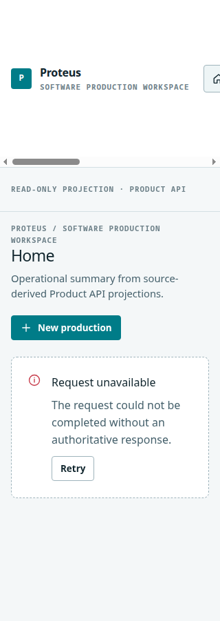
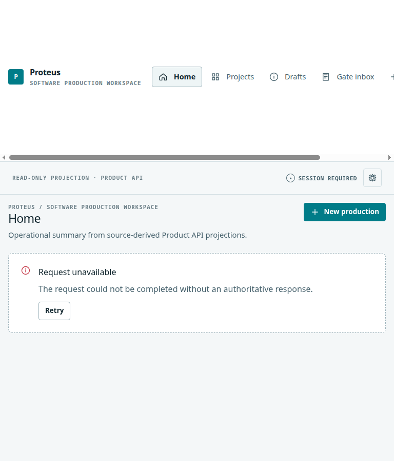
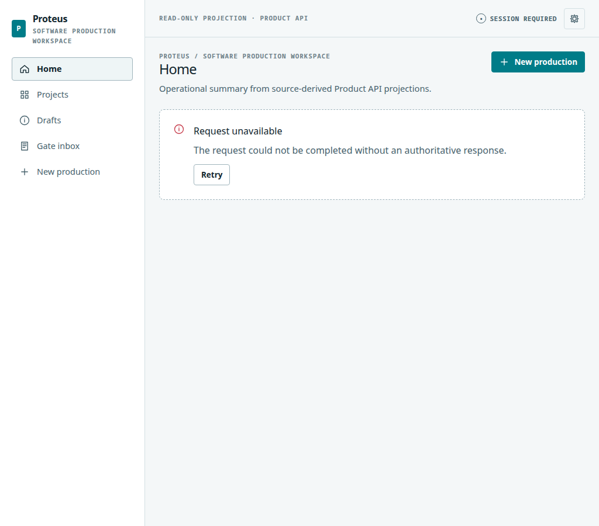

# E9-only Acceptance Closure Delivery Report

## Verdict

**E9 Acceptance Closure: PASS.** The closure completes the E9 visual, localization, preference, accessibility, and responsive-browser acceptance scope. **E11 remains PARTIAL / ACCEPTANCE GAP**, so the combined E9–E11 Wave A must not be described as COMPLETE.

## Delivered acceptance evidence

| Area | Evidence | Result |
|---|---|---|
| Locale catalog | 22 typed BCP 47 catalogs, full keyset validation, non-English core-string quality gate | PASS |
| Formatting | Locale-aware percent, duration, byte, ordinal, date, and pseudo-localization helpers | PASS |
| Directionality | Arabic and Hebrew RTL document direction; technical value isolation | PASS |
| Themes and typography | 10 themes, constrained accents, UI/mono fonts, size, line-height, density, reduced motion | PASS |
| Accessibility | Skip navigation, focus-visible treatment, labelled controls, dialog, live state, non-colour markers | PASS |
| Browser combinations | Arabic RTL + high-contrast dark; Simplified Chinese + CJK + high-contrast dark | PASS |
| Responsive production screenshots | 320 px, 768 px, 1024 px | PASS |
| Static user-text fallback | No core visible English fallback in any non-English locale | PASS |

## Regression evidence

| Gate | Result |
|---|---:|
| Frontend Vitest | 66 tests / 9 files PASS |
| TypeScript build | PASS |
| Production Vite build | PASS |
| oxlint | 0 warnings / 0 errors |
| no-DB unittest discovery | 707 run / 438 skipped / 0 failures |
| Fresh PostgreSQL 16 Full Runtime (0001–0032) | 707 run / 12 skipped / 0 failures in 401.911s |

The Full Runtime output included existing Python `ResourceWarning` notices about unclosed harness files, but no test failure, error, migration drift, authority regression, or E10 session regression occurred.

## E11 acceptance boundary

The Project Operations route continues to render only existing E7 source-derived workflow, execution, verification, evidence, waiting, recovery, and event projections. Its recovery affordance navigates to the existing Gate Inbox. It still does not expose a user-callable authority command because the public Product API lacks a compliant OIDC-facing retry, reconcile, reverify, permitted cancel, or acknowledgement semantic surface; internal pause/resume/cancel handlers require Control Plane authority. This closure does not bridge or bypass that boundary.

## Final scope statement

No migration, data schema, role, grant, identity format, P0–P6 state machine, E1–E8 authority semantic, E10 session transport, or E11 command was changed. E12–E16 were not entered.

## Browser evidence artifacts

The recorded browser findings and production screenshots are repository evidence rather than synthetic mockups.

| Viewport | Artifact |
|---|---|
| 320 px mobile |  |
| 768 px tablet |  |
| 1024 px desktop |  |

The narrative evidence is in `evidence/e9-only-acceptance/BROWSER_ACCEPTANCE_FINDINGS.md`.
