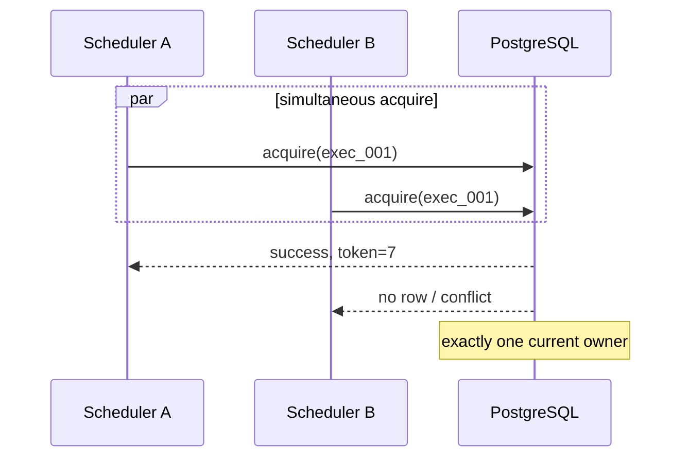
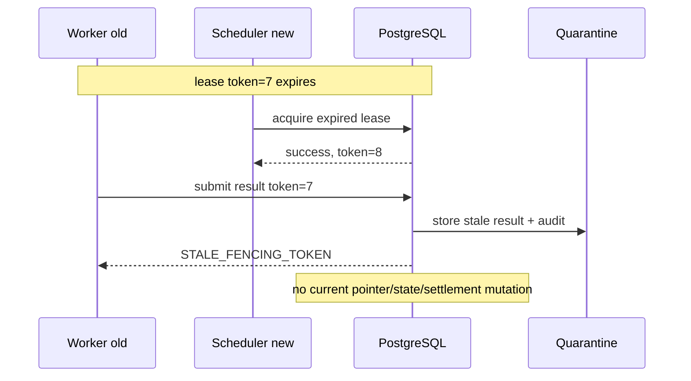
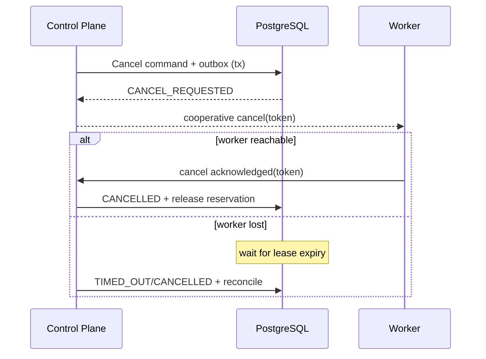
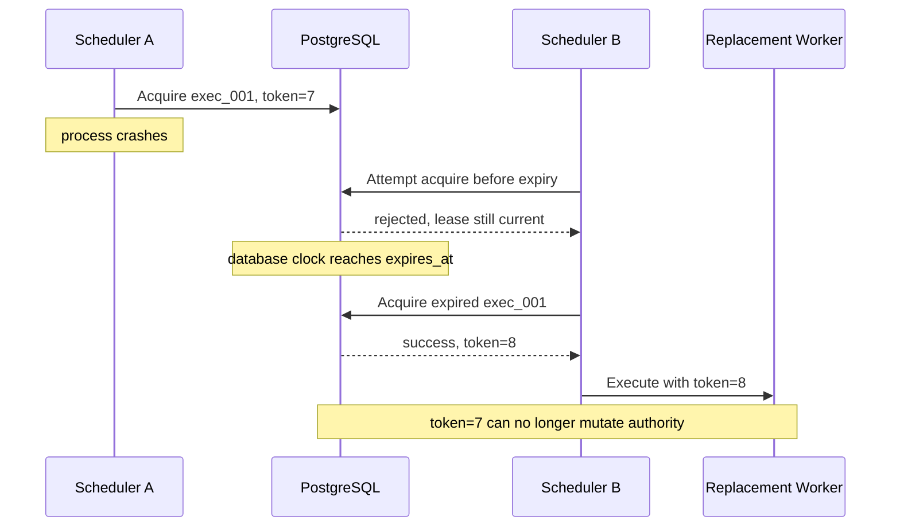
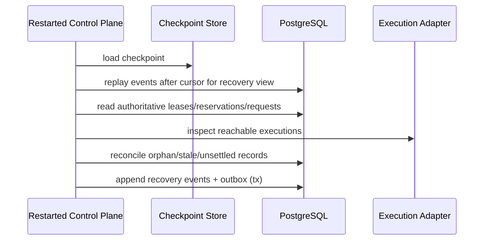

# Hermes Execution Lease Protocol V1.0

**Status:** NORMATIVE DRAFT  
**Version:** 1.0.0  
**Phase:** P2, with contracts specified before implementation  
**Related:** [Runtime Normative Specification](Hermes_Runtime_Normative_Spec_V1.0.md), [Command/Event Protocol](Hermes_Command_Event_Protocol_V1.0.md), [Conformance Tests](Hermes_Conformance_Test_Spec_V1.0.md)

## 0. P2-0 amendment: admission and reservation handoff

[Hermes P2 Execution Admission Normative Specification V1.0](Hermes_P2_Execution_Admission_Normative_Spec_V1.0.md)
is the controlling P2-0 amendment for execution admission, Reservation handoff,
`PREPARING`/`QUEUED` semantics, Capability/Context/Sandbox freeze points,
AgentRun evolution and P2/P3 test ownership.

Where this protocol says PREPARING reserves resources, read it as the pre-P1
generic lifecycle. After P1 Selection, non-zero selected actions already have an
ACTIVE ResourceReservation. P2 MUST bind and hand off that existing Reservation
to the ExecutionRequest and MUST NOT create a second Reservation for the same
DecisionRecord/SelectedAction/Preparation. `QUEUED` MUST mean all admission
prerequisites are frozen and valid, not merely that a selected action exists.

## 1. Scope and non-goals

This protocol defines ExecutionRequest queueing, PostgreSQL Lease, Fencing Token, result admission, cancellation, retry and accounting interaction. It does not choose business actions, diagnose failures, produce Verification verdicts, require Kubernetes/Kafka/Redis, or define a fixed Worker organization.

## 2. Roles

- Control Plane creates an ExecutionRequest only from a selected, allowed Action.
- Queue persists runnable requests and priority.
- Scheduler leases only already admitted `QUEUED` requests, renews/takes over
  leases and monitors execution. Capability, Context, Sandbox and Reservation
  handoff are completed before queueing by admission/preparation authority.
- Worker executes one leased request under a CompiledSandboxProfile.
- Execution Adapter returns structured Result and metrics, never state transitions.
- Verification runs independently after admitted Artifact creation.

## 3. ExecutionRequest lifecycle

```text
CREATED -> QUEUED -> LEASED -> RUNNING -> RESULT_SUBMITTED
        -> COMPLETED | FAILED | CANCELLED | TIMED_OUT

LEASED/RUNNING -> QUEUED       (lease expiry and retry allowed)
RESULT_SUBMITTED -> QUARANTINED (stale token or invalid identity)
```

`COMPLETED` means execution protocol completion, never Task PASS.

## 4. Lease record

```json
{
  "resource_id": "exec_001",
  "owner": "scheduler_02/worker_017",
  "acquired_at": "2026-08-12T10:01:02.000Z",
  "expires_at": "2026-08-12T10:02:02.000Z",
  "fencing_token": 7,
  "heartbeat_at": "2026-08-12T10:01:32.000Z",
  "lease_version": 11
}
```

The database clock MUST define expiry. Client clocks MUST NOT decide ownership.

## 5. Resource reservation before Lease

For an Action that consumes metered resources in the pre-P1 generic model:

```text
Selected Action
  -> create ExecutionRequest in non-runnable PREPARING state
  -> atomically reserve estimated resources
  -> mark ExecutionRequest QUEUED
  -> Scheduler may acquire Lease
```

After P1, Selection has already created ACTIVE ResourceReservation for non-zero
selected actions. P2 request preparation binds that Reservation and transitions
to `QUEUED` in one local transaction. If request preparation fails after a
durable preparation record, it MUST either roll back, mark deterministic
`PREPARATION_FAILED` and release, or retain only under a bounded idempotent retry
and reconcile policy. A Lease MUST NOT be granted without a valid Reservation
handoff when the resource dimension requires one.

## 6. Atomic acquire

Lease acquisition MUST be one PostgreSQL atomic conditional operation or equivalent row-lock transaction:

```sql
UPDATE execution_request
SET lease_owner = :owner,
    acquired_at = clock_timestamp(),
    lease_expires_at = clock_timestamp() + :ttl,
    fencing_token = fencing_token + 1,
    state = 'LEASED',
    version = version + 1
WHERE execution_request_id = :id
  AND state IN ('QUEUED', 'LEASED', 'RUNNING')
  AND (lease_owner IS NULL OR lease_expires_at <= clock_timestamp())
RETURNING fencing_token, lease_expires_at, version;
```

Actual SQL MAY differ, but two contenders MUST result in exactly one successful current owner. “SELECT then UPDATE”, process mutex and unfenced distributed lock are forbidden correctness foundations.

### 6.1 P2-3 authority table amendment

The P2-3 implementation keeps P2-2 `execution_requests` and
`execution_queue_items` immutable as admission/enqueue snapshots. Scheduler
state is authoritative in separate current tables:

```text
execution_request_current_states
execution_queue_current_states
execution_leases
execution_fencing_counters
execution_lock_ownerships
```

Therefore the immutable snapshot column `execution_requests.request_state =
'QUEUED'` means “admitted and originally queued,” while
`execution_request_current_states.request_state` owns the mutable
`QUEUED <-> LEASED` Scheduler state. This avoids rewriting audit facts while
preserving the protocol invariant that the current request has at most one
active Lease.

P2-3 uses the versioned profile `p2-default/1`: 30000 ms initial TTL, 10000 ms
renew interval, 30000 ms maximum extension, 300000 ms maximum lifetime, immediate
takeover after PostgreSQL-clock expiry, zero requeue backoff and acquisition
batch size one.

## 7. Fencing Token

Every successful initial grant or re-grant MUST increment a monotonically increasing token for that ExecutionRequest. Renew by the current owner MUST keep the token. All heartbeat, renew, complete, cancel acknowledgement and result submission MUST carry token.

Every downstream authority write MUST compare the submitted token with the current token. An old token MUST NOT update ExecutionRequest, Artifact current pointer, valid usage settlement, Task state or current Evidence.

## 8. Renew and heartbeat

Heartbeat records liveness; renew extends ownership. They MAY be one Command but semantics remain distinct. A renew succeeds only when owner and token match and Lease has not been superseded. Implementations MAY allow a small renewal grace only if no new token has been granted; after re-grant, old owner always loses.

Heartbeat loss does not prove Worker death. It permits Lease expiry according to policy. If the old Worker later submits, fencing protects authority.

### 8.1 Lease release

Only the current owner/token or an authorized Control Plane cancellation/recovery Command MAY release a Lease. Release MUST be a conditional transaction that clears current ownership, records terminal or requeue state, writes the corresponding Event/Outbox and triggers Reservation settlement/release. A stale owner release MUST fail and MUST NOT clear a newer Lease. Normal completion does not release ownership until Result admission has durably recorded its disposition.

## 9. Normal result admission

```mermaid
sequenceDiagram
    participant CP as Control Plane
    participant S as Scheduler
    participant DB as PostgreSQL
    participant W as Worker
    participant V as Verification
    CP->>DB: Create request + reservation + outbox (tx)
    S->>DB: Acquire lease atomically
    DB-->>S: token=7
    S->>W: Execute(request, token=7)
    W->>DB: Heartbeat / renew(token=7)
    W->>CP: Submit CompletionClaim + Result(token=7)
    CP->>DB: Validate owner/token; admit candidates (tx)
    CP->>V: Verify exact Artifact hash
    V-->>CP: VerificationResult + Evidence
    CP->>DB: Guarded Task transition + outbox (tx)
```

Result admission MUST validate request, Worker/run identity, current owner, token, policy constraints, declared export paths, Artifact hashes and usage schema. It creates CompletionClaim/Artifact Candidates, not PASS.

### 9.1 P2-4 implementation checkpoint

P2-4 implements Result admission through the existing P0 AgentRun,
CompletionClaim, Artifact and P1 Accounting models. Worker admission first
acknowledges a current ACTIVE Lease and moves the ExecutionRequest from `LEASED`
to `RUNNING`. Later Artifact Candidate, Evidence Candidate, Usage sample and
terminal Result writes must carry the same current request/run/attempt/Lease
version/fencing token/context binding.

An accepted terminal Result closes execution authority, not task correctness:
`ExecutionResult(SUCCEEDED)` may promote the selected Artifact Candidate and
create a CompletionClaim, but it does not create a VerificationResult and does
not mark a Task `PASSED` or `FAILED`.

When terminal Result admission succeeds, the same PostgreSQL transaction writes
the immutable Result, CompletionClaim/settlement links, ResourceReservation
settlement or release, terminal Run/Request/Queue state, Events, Outbox and
CommandReceipt. The Lease row remains a Lease lifecycle record: it is moved to
`RELINQUISHED` and its business terminal outcome is recorded as terminal reason;
Lease state is not overloaded with `SUCCEEDED` or `FAILED`.

## 10. Two Schedulers compete



Both Schedulers MAY observe QUEUED before the race; correctness depends on the atomic write, not the observation.

## 11. Expiry, takeover and late result



Quarantine MUST preserve request, owner, submitted/current token, hashes, metrics, received time and rejection reason. A human/recovery process MAY inspect it but MUST issue a new explicit Command to adopt any content.

## 12. Cancellation and timeout

Cancellation is a Control Plane Command. It records `CANCEL_REQUESTED`, current token and Outbox Event. Scheduler sends cooperative cancel; Worker acknowledges with current token. If disconnected, authority waits until acknowledgement or Lease expiry, then adapter MAY force terminate.



Result racing with cancellation is accepted only according to a documented state Guard; token validity alone does not override cancellation state.

## 13. Crash and partition behavior

**Scheduler crash:** Lease remains until expiry. Another Scheduler may re-grant after expiry with a new token. No manual unlock is required.

**Worker crash:** Missing heartbeat leads to expiry; unused reservation is released and measured consumption settled by reconcile.

**Control Plane crash:** Database transaction is all-or-nothing. After restart it reads authoritative request, Outbox, Lease and Reservation, then reconciles.

**Network partition:** A partitioned Worker may continue locally but loses authority after expiry/re-grant. Fencing prevents late writes.

**Heartbeat lost, Worker alive:** treated as uncertain execution; new Worker MAY take over after expiry. Duplicate external side effects require Sandbox/tool-specific idempotency keys and are not solved by database fencing alone.

### 13.1 Scheduler crash recovery sequence



## 14. Retry Scheduling

Scheduler MAY retry transient adapter startup, lost process, temporary tool transport or unavailable Worker capacity within ExecutionRequest retry policy. A verification FAIL, compile failure caused by source, wrong architecture or failed acceptance criterion is a business outcome and MUST emit Feedback to Situation / Diagnosis / Planner.

Every retry that re-grants a Lease increments token. Strategy switch or repair creates a new Action/ExecutionRequest rather than silently mutating original business parameters.

## 15. Resource Accounting lifecycle

```text
allocation
  -> reservation (before QUEUED/Lease)
  -> consumption samples (during valid Lease)
  -> settlement (accepted completion/failure)
  -> release unused amount
```

- Cancellation/timeout MUST settle known consumption and release remainder.
- Worker crash MUST leave a reconcilable reservation, not silently spend or release it.
- Stale-token usage MAY be recorded as observed cost but MUST NOT settle the current Worker's reservation as if valid.
- Concurrent reservation MUST use a conditional update/row lock so `reserved + consumed <= limit`.
- An ExecutionRequest that fails to become QUEUED MUST not retain reservation after transaction/reconcile.

## 16. Lock scopes and concurrency

Write Actions for one Task are serial by default. Read-only diagnosis MAY run concurrently when Policy and Budget allow. P2-3 uses the ADR-0045 declared scopes:

| Scope | Protects |
| --- | --- |
| repository | repository-level mutation |
| workspace | workspace-level mutation |
| branch_ref | branch/ref mutation |
| artifact_namespace | artifact namespace mutation |
| external_environment | external account/environment mutation |
| deployment_target | deployment target mutation |

Locks MUST be acquired in ADR-0045 canonical kind order and stable scope order to
reduce deadlock. Lock ownership is bound to Lease ID and fencing token; lock
expiry MUST NOT exceed Lease expiry. A Lease grants execution ownership but does
not replace all domain locks.

P2-3 Queue fairness is best effort:

```text
priority DESC -> available_at ASC -> enqueued_at ASC -> queue_item_id ASC
```

`FOR UPDATE SKIP LOCKED` MAY skip a row already locked by another Scheduler
claim transaction, and a row whose lock scopes conflict with an active unexpired
Lease MAY be skipped so another eligible item can run. Strict global fairness,
starvation observation and operational remediation remain P3.

## 17. Worker and Verification isolation

Worker token MUST not authorize Verification. Verification MUST use an independent service/AgentRun identity and separate execution context. Scheduler MUST NOT select the implementation run as verifier for high-risk tasks. Verification result admission checks verifier policy and Artifact hash separately from Worker Lease.

## 18. Recovery sequence



Replay informs recovery but MUST NOT overwrite authoritative state directly. Reconcile uses explicit guarded Commands and MUST be idempotent.

## 19. Protocol invariants

1. At most one current Lease owner/token per ExecutionRequest.
2. Fencing token monotonically increases on re-grant.
3. Stale token never mutates authority/current pointers/current settlement.
4. Every stale Result is quarantined and audited.
5. No metered Lease without valid Reservation.
6. `COMPLETED != Task PASSED`.
7. Scheduler retry never hides business failure.
8. Worker and verifier identities/contexts are isolated.
9. SandboxProfile Compiler cannot widen Policy constraints and fails closed.
10. Capability matching uses capabilities, not fixed departments.

## 20. Acceptance scenarios

Required: CT-002, CT-003, CT-005 and FI-09 through FI-12, FI-16, FI-17 in [Conformance Test Specification](Hermes_Conformance_Test_Spec_V1.0.md). Lease and budget races MUST use separate PostgreSQL connections/processes and a synchronization barrier, not random sleeps.

## 21. Open questions

- Lease TTL and heartbeat interval profiles by execution type.
- External side-effect idempotency contract for each tool adapter.
- Maximum takeover attempts before new Situation.
- Exact quarantine retention and authorized adoption process.
